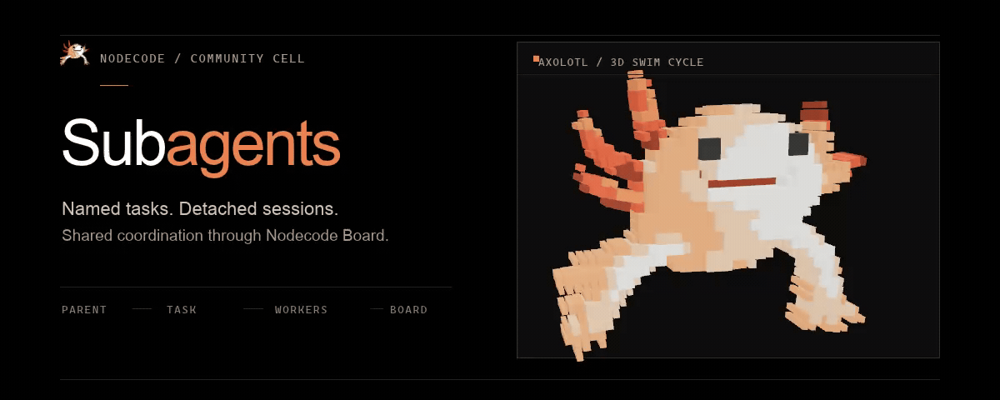
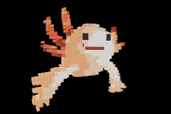
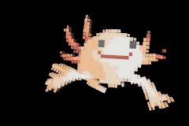

# Nodecode Subagents

<p align="center">
  <picture>
    <source media="(prefers-reduced-motion: reduce)" srcset="artwork/subagents-hero.png" />
    
  </picture>
</p>

<p align="center">
  <a href="#install">Install</a> ·
  <a href="#configure">Configure</a> ·
  <a href="#eval-apis">Eval APIs</a> ·
  <a href="#sessions-and-coordination">Sessions and coordination</a>
</p>

An OMP-style Nodecode cell for parallel child sessions and IRC-style coordination on Nodecode's durable Board. Nodecode's built-in `eval` is the sole model tool; this cell adds reusable Lisp APIs, not provider-facing tools.

## Install

<p align="right">
  <picture>
    <source media="(prefers-reduced-motion: reduce)" srcset="artwork/media/axolotl-setup-still.png" />
    
  </picture>
</p>

Clone this repository into Nodecode's local cells directory, then restart Nodecode or run `(restart-cells)`:

**Windows · PowerShell**

```powershell
git clone https://github.com/drvova/nodecode-subagents "$HOME\.nodecode\cells\nodecode-subagents"
```

**macOS · Linux**

```sh
git clone https://github.com/drvova/nodecode-subagents "$HOME/.nodecode/cells/nodecode-subagents"
```

Nodecode must have local-cell loading enabled. Install and enable the `nodecode-board` cell as well; it provides the durable board used for coordination.

## Configure

<p align="right">
  <picture>
    <source media="(prefers-reduced-motion: reduce)" srcset="artwork/media/axolotl-configure-still.png" />
    
  </picture>
</p>

Enable both cells in `~/.nodecode/config.jsonc`:

```jsonc
{
  "board": { "enabled": true },
  "subagents": {
    "enabled": true,
    "max_agents": 4
  }
}
```

`max_agents` accepts 1–5 and controls concurrency only. This cell adds no per-worker or team-wide token/time ceiling and does not override Nodecode's turn-budget policy. Workers inherit the parent's model selection; Nodecode and the selected provider/model remain responsible for their own limits.

When upgrading from 0.1.x, remove `budget_tokens` and `budget_seconds` from `~/.nodecode/config.jsonc`; the cell no longer reads them.

## Eval APIs

<p align="right">
  <picture>
    <source media="(prefers-reduced-motion: reduce)" srcset="artwork/media/axolotl-eval-apis-still.png" />
    
  </picture>
</p>

The cell exports `subagents:task`, `subagents:agents`, and `subagents:irc`. Call them as Common Lisp forms through Nodecode's built-in `eval`:

```lisp
(subagents:task '((:name "worker" :task "Inspect the parser and report findings."))
                :context "The goal is to identify parsing edge cases.")
(subagents:agents "list")
(subagents:irc "send" :message "I found an edge case in the parser.")
```

`task` has signature `(task tasks &key (context "") (workspace "") (team-id "") (await nil) (timeout-seconds 60))`; each assignment is a plist with `:name`, `:task`, and optional `:workspace`.

`agents` has signature `(agents op &key (team-id "") (agent "") (timeout-seconds 60))`. `op` is `"list"`, `"wait"`, or `"stop"`.

`irc` has signature `(irc op &key (team-id "") (to "all") (message "") (reply-to "") (from "") (after -1) (limit 25) (timeout-seconds 30) (await-reply nil))`. `op` is `"join"`, `"send"`, `"inbox"`, `"history"`, `"wait"`, or `"roster"`.

## Sessions and coordination

<p align="right">
  <picture>
    <source media="(prefers-reduced-motion: reduce)" srcset="artwork/media/axolotl-sessions-still.png" />
    
  </picture>
</p>

A `task` request accepts `:name` and `:task` assignments and may include shared context, a common workspace, per-assignment workspaces, and an `:await` timeout. Child sessions inherit the parent's model selection, not its conversation; include the context they need explicitly.

Workers use the workspace paths you provide. Those directories are shared, not isolated worktrees. Give workers separate existing directories when they may edit the same files.

`agents` accepts `"list"`, `"wait"`, and `"stop"`. `irc` accepts `"join"`, `"send"`, `"inbox"`, `"history"`, `"wait"`, and `"roster"`; messages are stored on Nodecode Board. These are Lisp APIs called through the built-in eval, not separate provider-facing tools.

## Artwork

The animated top-left Foresight Labs mark is not a downloadable 3D model: it is a 312 × 266 pixel-art SVG whose path geometry changes on pointer hover, with a canvas reticle that follows the pointer. This README keeps the source's seven color layers and 253 rectangles, extrudes them into a thicker 3D relief, and adds a faster swim loop with independent gill and limb motion, body breathing, and a blink.

From `artwork/`, regenerate the geometry, STL preview, animation loops, and reduced-motion stills with [RAEA](https://raea.io/install) and `ffmpeg` installed:

```powershell
python .\export-axolotl-stl.py
.\render-readme-mascot.ps1
```

The live vector source is [`nodecode-axolotl.svg`](artwork/media/nodecode-axolotl.svg); the source-derived model has an [interactive STL preview](artwork/media/nodecode-axolotl.stl). RAEA and ffmpeg are needed only to regenerate artwork, not to run this cell.

## License

MIT. See [LICENSE](LICENSE).

## Credits

Built for [Nodecode](https://github.com/nodecode-ai/nodecode), the agent environment at [nodecode.ai](https://nodecode.ai). This cell uses Nodecode's documented cell and eval APIs; it does not copy upstream code.
