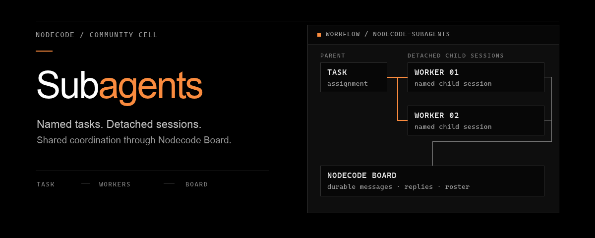

# Nodecode Subagents

<p align="center">
  
</p>

<p align="center">
  <a href="#install">Install</a> ·
  <a href="#configure">Configure</a> ·
  <a href="#tools">Tools</a> ·
  <a href="#sessions-and-coordination">Sessions and coordination</a>
</p>

An OMP-style Nodecode cell for parallel child sessions and IRC-style coordination on Nodecode's durable Board.

## Install

Clone this repository into Nodecode's local cells directory, then restart Nodecode or run `(restart-cells)`:

**Windows · PowerShell**

```powershell
git clone https://github.com/drvova/nodecode-subagents "$HOME\.nodecode\cells\nodecode-subagents"
```

**macOS · Linux**

```sh
git clone https://github.com/drvova/nodecode-subagents "$HOME/.nodecode/cells/nodecode-subagents"
```

Nodecode must have local-cell loading enabled. Install and enable the `nodecode-board` cell as well; it provides the durable board used for coordination.

## Configure

Enable both cells in `~/.nodecode/config.jsonc`:

```jsonc
{
  "board": { "enabled": true },
  "subagents": {
    "enabled": true,
    "max_agents": 4
  }
}
```

`max_agents` accepts 1–5 and controls concurrency only. This cell adds no per-worker or team-wide token/time ceiling and does not override Nodecode's turn-budget policy. Workers inherit the parent's model selection; Nodecode and the selected provider/model remain responsible for their own limits.

When upgrading from 0.1.x, remove `budget_tokens` and `budget_seconds` from `~/.nodecode/config.jsonc`; the cell no longer reads them.

## Tools

| Tool | What it does |
| --- | --- |
| `task` | Starts detached worker sessions from one or more named assignments. |
| `agents` | Lists, waits for, or stops workers. |
| `irc` | Joins the shared Board, sends and reads messages, waits for replies, or lists members. |

## Sessions and coordination

A `task` request accepts `{ "name", "task" }` assignments and may include shared context, a common workspace, per-assignment workspaces, and an `await` timeout. Child sessions inherit the parent's model selection, not its conversation; include the context they need explicitly.

Workers use the workspace paths you provide. Those directories are shared, not isolated worktrees. Give workers separate existing directories when they may edit the same files.

`agents` accepts `list`, `wait`, and `stop`. `irc` accepts `join`, `send`, `inbox`, `history`, `wait`, and `roster`; messages are stored on Nodecode Board. These are provider-facing tools, not Lisp functions to call from `eval`.

## Artwork

The header is rendered with [RAEA](https://raea.io/install). The composition and measured Nodecode palette are in `artwork/`; from that directory, regenerate the image with:

```sh
raea render readme-hero.tsx --frame 0 -o subagents-hero.png
```

RAEA is only needed to regenerate the README image, not to run this cell.

## License

MIT. See [LICENSE](LICENSE).
